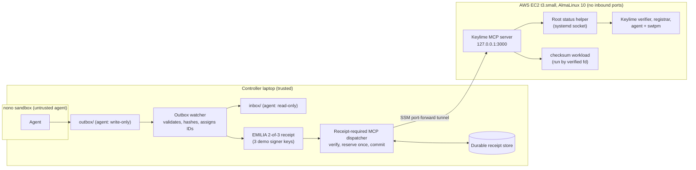

# Design Document

*Demo 2 version (10/21). Updated for `demo-3` and `final-demo`.*

This document describes what we actually built for Demo 2, how to run it, what
it shows, and what it does not show. Section 5 lists where Demo 2 differs from
the milestones in our design proposal.

## 1. Architecture

An AI agent never gets to run a workload directly. It can only ask. A request
runs only if all of these hold:

1. the agent is confined by **nono** and can only write a request file;
2. a trusted watcher turns that file into an exact, hashed action;
3. **two of three** approvers sign an **EMILIA** receipt bound to that exact
   action;
4. a receipt-checking MCP dispatcher verifies the receipt and reserves it so it
   can be used only once;
5. the execution node's **Keylime** attestation is fresh, passing, and belongs to
   the expected agent;
6. the workload and input bytes match the approved digests and are executed
   from the already-verified file descriptors.

If any step fails, is unavailable, or is ambiguous, the request is denied.



### Components

| Component | Code | Role |
| --- | --- | --- |
| Agent request tool | `src/agent_tool/submit_request.py` | Writes one schema-valid request to the outbox (`*.tmp`, then rename). Convenience only, not a security boundary. |
| nono profile | `src/agent_tool/nono_profile.py` | Generates the sandbox profile: outbox write-only, inbox read-only, no network, credential variables stripped. |
| Request schema | `src/request_schema.json` | Strict JSON Schema (`additionalProperties: false`), allowlisted operations. |
| Outbox watcher | `src/controller/outbox_watcher.py` | Trusted. Opens files with `O_NOFOLLOW` and `O_NONBLOCK` and accepts only regular files. Enforces size limits, computes digests, checks the target allowlist, and assigns the occurrence ID and policy version. |
| EMILIA adapter and demo signers | `src/controller/emilia_adapter.py`, `src/demo/demo_controller.mjs` | Builds the action that approvers sign and issues 2-of-3 quorum receipts with three locally generated demo keys. |
| Receipt-required dispatcher | `src/controller/receipt_required_mcp.mjs` | Uses `@emilia-protocol/require-receipt` 0.9.0. Refuses with HTTP 428 unless a pinned issuer's receipt matches the exact action hash. Reserves the receipt in a durable store before the effect and burns it if the outcome is uncertain. |
| Keylime MCP client | `src/controller/keylime_mcp_client.mjs` | Calls the cloud MCP with a bearer token over HTTPS or a tunnelled loopback. Rejects stale, future-dated, or mismatched attestation results. |
| Keylime MCP server | `src/keylime_mcp/server.mjs`, `attest_and_deploy.mjs` | Runs on the node. Requires a fresh `PASS` for the configured agent UUID, checks workload and input digests, then runs the workload from file descriptors 3 and 4. |
| AWS deployment | `infra/aws/` | CloudFormation template, deploy, tunnel, and teardown scripts. Access is through Systems Manager only. |

## 2. Design decisions

| Decision | What we chose | Alternatives and why not |
| --- | --- | --- |
| How intent leaves the sandbox | A structured JSON file in a write-only outbox | nono's built-in approval webhook was considered. The file handoff keeps the agent fully networkless and lets the trusted side compute every security-relevant field. |
| What the agent may request | An allowlisted `operation` plus digests, never shell strings | Free-form commands make "approve this exact action" meaningless. |
| Where security fields come from | The watcher computes digests, occurrence ID, and policy version itself | Fields the agent supplies are only claims. A request whose digest does not match is rejected. |
| Receipt format | EMILIA `require-receipt` gate with a v0.1 Action Risk manifest | We use EMILIA's gate rather than our own crypto. The v0.2 Action Control manifest is newer; migrating to it is follow-up work. |
| One-use receipts | Atomic `mkdir` reservation, then commit, with fsync | An in-memory set loses replay protection on restart. The scenario `replay_after_restart` shows it survives restarts. |
| Uncertain outcomes | Burn the receipt (`effect_indeterminate`) | Retrying could run the workload twice. The cost: a Keylime outage during a request uses up that approval, and a new approval is needed. |
| Running the approved bytes | Hash through an open fd, then execute `/proc/self/fd/3` on `/proc/self/fd/4` | Re-opening the path after hashing allows a swap between check and use. |
| Root-only Keylime status | A root systemd socket-activated helper, readable only by the `ec528-mcp` group | `sudo` is blocked by the service's `NoNewPrivileges=true`, and we did not want to remove that hardening. |
| Cloud | AWS EC2 (AlmaLinux 10, `t3.small`) | See Section 5 for why not MOC. Ubuntu has no Keylime package, while AlmaLinux 10 ships Keylime 7.14.1 and the Rust agent. |
| TPM | swtpm (software TPM) | NitroTPM needs a custom UEFI AMI and IMA setup; it is planned for Demo 3. swtpm proves the Keylime protocol flow but not a hardware root of trust. |
| SELinux | Kept enforcing; added a narrow `ec528_swtpm` policy module | Disabling SELinux would have been faster but weakens the whole host. |
| Language | Python for the agent side and watcher; Node.js for EMILIA and MCP | The proposal said Python throughout. EMILIA's receipt gate and the MCP SDK are JavaScript, and we use them directly rather than port the crypto. |

**Things that did not work at first, all fixed before the recorded runs:**

- **The watcher could be frozen.** The agent could create a FIFO in the outbox, and opening it blocked the watcher. Fixed with `O_NONBLOCK`, with a regression test.
- **The workload never received its files.** `execFile` in Node silently ignores the `stdio` option, so the verified file descriptors never reached the child. Fixed by switching to `spawn`, and tested on Linux.
- **Timeouts left processes running.** A timeout did not kill grandchildren of the workload. Fixed by killing the whole process group.
- **The status check could never run.** `sudo` inside a `NoNewPrivileges` service always failed. Fixed with the socket helper.
- **SELinux stopped swtpm from starting** under our systemd unit. Fixed with a policy module rather than disabling SELinux.

## 3. Setup

### Local machine (all non-cloud experiments)

Tested on macOS 26 (Darwin 25.1), Apple Silicon. Linux-only code paths were
also tested in a `node:22-bookworm-slim` container.

| Dependency | Version used |
| --- | --- |
| Node.js | 24.11.0 (`>=20` required) |
| Python | 3.11 or newer (CI uses 3.11) |
| nono | 0.79.0 |
| `jsonschema` (Python) | 4.25.1 |
| npm packages | pinned in `package-lock.json` (`@emilia-protocol/require-receipt` 0.9.0, MCP SDK 2.x) |

```bash
git clone https://github.com/ec528-fall26/zero-trust.git
cd zero-trust
git checkout demo-2
npm ci
python3 -m venv .venv
.venv/bin/pip install -e .
# install nono 0.79.0: https://nono.sh/
nono --version
```

The commands below use `.venv/bin/python`, because the system `python3` usually
does not have `jsonschema`.

**Where to put the checkout.** Clone it under your home folder (for example
`~/ec528-demo`), not under `/tmp`, `/var`, or an iCloud-synced folder:

- nono's built-in macOS rules let any sandboxed program read `/private/var`
  (which holds the per-user temp folder) and read and write `/private/tmp`.
  A checkout there makes the confinement check fail, and the end-to-end
  experiment refuses to run (see Section 5).
- In iCloud Drive (`~/Documents`, `~/Desktop`), loading the Node packages took
  about 60 seconds instead of 0.1 seconds and stalled experiments.

### Cloud node (attestation and end-to-end experiments only)

These experiments need an AWS account. On our account the instance cost a few
cents per run.

| Dependency | Version used |
| --- | --- |
| AWS CLI | v2, plus the Session Manager plugin |
| Region / AMI | `us-east-2`, `ami-0281f4b4279b17b5b` (official AlmaLinux OS 10 x86_64) |
| Instance | `t3.small`, 16 GB encrypted gp3, auto-terminates after 4 hours |
| Keylime | 7.14.1-5.el10_2.1 (verifier, registrar, tenant; Rust agent) |
| swtpm | 0.9.0-5.el10 |
| `cfn-lint` | run through `uvx cfn-lint` |

The deploy script expects an AWS CLI profile named `ec528-deployer` that can
create the stack. It also expects an existing EC2 instance profile that lets the
node register with Systems Manager. The default name is
`EC528ZeroTrustInstanceProfile`; set it with the `InstanceProfileName`
parameter in `infra/aws/main.yaml`.

```bash
./infra/aws/deploy.sh                 # validation only: lints the template, no charges
./infra/aws/deploy.sh --apply         # creates the instance (billable)
./infra/aws/open-tunnel.sh            # keep running: forwards localhost:3000 to the node
./infra/aws/teardown.sh ec528-zero-trust-demo   # deletes everything when finished
```

The experiments read the MCP bearer token from `build/aws-keylime/mcp-token`
(mode `0600`, ignored by Git). `make fetch-token STACK=<stack>` copies it from
the instance through Systems Manager. The token's value is therefore kept in
the account's SSM command history; it is per instance and useless once the
stack is torn down, but never display that command's output.

## 4. Running the experiments

Run every command from the repository root. Each experiment writes a JSON file
under `results/` containing the commit hash, whether the working tree had
uncommitted changes (`repository_dirty`), versions, per-scenario
expected/observed/pass, and its limitations. Raw responses are stored only as
SHA-256 digests, so no tokens or keys end up in Git.

### Experiment 0: unit and regression tests

| | |
| --- | --- |
| Supports | "The checks fail closed." Covers receipt binding, replay, malformed input, FIFO and symlink handling, and stale or mismatched Keylime results. |
| Command | `make ci PYTHON=.venv/bin/python` |
| Expected runtime | about 2 minutes |
| Expected output | Python `Ran 13 tests ... OK`; Node `pass 35`, `fail 0`, `skipped 1` on macOS (the Linux-only fd test), or all 36 tests passing on Linux |

### Experiment 1: nono confinement

| | |
| --- | --- |
| Supports | "The agent can only write a request. It cannot read back, reach the network, call the MCP directly, or read controller secrets." |
| Command | `make integration-nono PYTHON=.venv/bin/python NONO_BINARY=$(command -v nono)` |
| Expected runtime | under 1 minute |
| Expected output | JSON with all 9 cases `"passed": true` |

The 9 cases: `outbox_write_allowed`, `outbox_read_blocked`, `inbox_read_allowed`,
`inbox_write_blocked`, `network_blocked`, `direct_mcp_bypass_blocked`,
`receipt_store_read_blocked`, `signer_key_read_blocked`, `mcp_token_read_blocked`.

### Experiment 2: 2-of-3 exact-action authorization

| | |
| --- | --- |
| Supports | "No receipt, one signature, duplicate or untrusted signers, a changed action, expiry, and replay are all refused. Two distinct signers allow exactly one execution." |
| Command | `make demo2-authorization` (writes `results/demo2-authorization.json`) |
| Expected runtime | under 30 seconds |
| Expected output | `"status": "pass"` and 11 scenarios passing (see Section 5) |

### Experiment 3: cloud Keylime attestation (needs the AWS node and tunnel)

| | |
| --- | --- |
| Supports | "A fresh Keylime PASS lets the exact workload run. The wrong target is refused. Keylime being unavailable fails closed." |
| Command | `./infra/aws/prepare-demo.sh`, then `KEYLIME_MCP_URL=http://127.0.0.1:3000/mcp KEYLIME_MCP_TOKEN_FILE=build/aws-keylime/mcp-token KEYLIME_ACTION_FILE=build/aws-keylime/action.json KEYLIME_TPM_TYPE=swtpm make demo2-attestation` |
| Expected runtime | about 1 minute, after deploying the node (allow roughly 15 minutes) |
| Expected output | `results/demo2-attestation.json` with `"status": "pass"` and 3 scenarios passing |

### Experiment 4: one continuous end-to-end run (needs the AWS node)

| | |
| --- | --- |
| Supports | The headline claim: nono → watcher → EMILIA 2-of-3 → receipt dispatcher → SSM tunnel → cloud Keylime → workload → read-only inbox status, all in one run. |
| Command | `PYTHON_BIN=.venv/bin/python node experiments/demo2_end_to_end.mjs` (opens its own SSM tunnel; also reads `AWS_PROFILE`, `AWS_REGION`, `AWS_STACK_NAME`, `KEYLIME_MCP_TOKEN_FILE`) |
| Expected runtime | about 2 minutes. It deliberately stops the Keylime agent and waits for attestation to go stale. |
| Expected output | `results/demo2-end-to-end.json` with `"status": "pass"`, 7 scenarios passing, and a timeline from `nono_profile_generated` to `readonly_inbox_status_observed` |

## 5. Claims and limitations

### Results recorded for Demo 2

Each result file records its exact source commit, dependency versions,
timestamps, and whether the working tree was dirty. The refreshed continuous
and IMA runs were generated from commit `7826c10` on 2026-10-20/21 with
`repository_dirty: false`. The instance IDs below are historical evidence; the
CloudFormation stack and all tagged EC2, EBS, and security-group resources were
deleted after the runs.

**Authorization** (`results/demo2-authorization.json`, 11/11):

| Scenario | Observed |
| --- | --- |
| `missing_receipt` | refused |
| `one_signer_pending` | pending, no receipt issued |
| `duplicate_signer` | not counted twice |
| `untrusted_signer` | refused |
| `two_distinct_signers` | receipt issued |
| `receipt_target_binding` | refused (`action_hash_mismatch`) |
| `exact_action` | executed once |
| `immediate_replay` | refused (`replay_refused`) |
| `replay_after_restart` | still refused after restart |
| `expired_evidence` | refused (`receipt_expired`) |
| `one_signer_expiry` | expired without execution |

**Continuous end-to-end run on AWS** (`results/demo2-end-to-end.json`, 7/7,
instance `i-00cf93b48c76bef44`, terminated):

| Scenario | Expected | Observed |
| --- | --- | --- |
| `no_receipt` | denied | HTTP 428 |
| `one_of_three_signatures` | pending and denied | HTTP 428, receipt not issued |
| `action_changed_after_approval` | denied | HTTP 428, `action_hash_mismatch` |
| `exact_action_end_to_end` | executed once | HTTP 200, Keylime verdict `trusted`, workload ran |
| `used_receipt_replay` | denied | HTTP 428, `replay_refused` |
| `keylime_agent_stopped` | denied | HTTP 500, `effect_indeterminate`, workload did not run |
| `keylime_agent_recovered` | executed once | HTTP 200 after re-enrollment and fresh attestation |

**Cloud attestation** (`results/demo2-attestation.json`, 3/3): fresh attestation
allows the exact workload; the wrong target is denied; Keylime unavailable fails
closed.

**IMA runtime-integrity run** (`results/ima-tamper.json`, 5/5, same terminated
instance):

| Scenario | Observed |
| --- | --- |
| `ima_active_before_tamper` | kernel IMA policy active; Keylime status `PASS` |
| `clean_node_allows_exact_workload` | HTTP 200; exact workload executed |
| `unapproved_program_measured` | unexpected executable recorded in the IMA log |
| `verifier_detects_unapproved_program` | Keylime changed to `FAIL` with `ima.validation.ima-ng.not_in_allowlist` in at most 2.2 seconds |
| `approved_request_denied_after_tamper` | HTTP 500 fail-closed response; workload did not execute |

### What these results do not show

- **swtpm is not a hardware root of trust.** It proves the Keylime protocol and
  our fail-closed handling, not that a physical chip vouched for the machine.
- **The checker and the checked machine are the same.** The Keylime verifier,
  registrar, agent, swtpm, and MCP all run on the one instance being attested.
  A compromised instance could lie about itself.
- **The three EMILIA signer keys are on one laptop.** This proves the 2-of-3
  protocol, not independent human approval.
- **IMA is real kernel measurement, but the TPM is emulated.** Linux IMA
  records executed files, then a userspace emulator copies PCR 10 into swtpm.
  Root on the node could forge this flow. The policy was generated from the
  node at boot (trust on first use), and tmpfs and the SSM per-command script
  directory are outside the measured set.
- **There is a freshness window.** We accept attestation up to 30 seconds old.
  A node that fails inside that window is still trusted until the result goes
  stale. The outage scenario waits 35 seconds for this reason.
- **An outage uses up the approval.** When Keylime is down, the receipt is
  burned as `effect_indeterminate` rather than retried, so the approvers must
  sign again.
- **What the end-to-end "one of three" scenario actually tests.** With one
  signature, no receipt exists yet, so the dispatcher sees the same "no receipt"
  case as `no_receipt`. A forged receipt carrying only one valid signature is
  refused by the gate in the unit test
  `the production profile accepts a real 2-of-3 quorum receipt`, but not in the
  live cloud run.
- **The controller trusts the node's report.** The cloud MCP returns the
  attestation verdict and evidence digest itself, so the controller cannot
  independently check them.
- **A prior temp-folder layout exposed read access to controller state.** It was
  fixed by moving experiment state under `build/runs/`. Before starting, the
  current end-to-end experiment asks `nono why --json` to confirm that every
  controller-only path is denied and fails closed otherwise. The refreshed
  result records `controller_state_unreadable_by_sandbox` with seven paths
  checked.
- **nono enforcement was tested on macOS (Seatbelt) only.** The agent ran on the
  laptop; Linux Landlock confinement of the agent was not part of these runs.
- **Small scale.** Each scenario ran once. The 20-trial and 50-run measurements
  in the proposal are not done yet.

### Changes from the Demo 2 milestones in the proposal

We are announcing these changes, as the course rules require:

| Proposal milestone | Status | Change and reason |
| --- | --- | --- |
| Exact-action 2-of-3 authorization (`demo2_authorization.sh`) | **Met** | As planned, plus target-binding and restart-replay cases. |
| Keylime enrollment with measured-boot and IMA runtime policy | **Partly met** | Real Keylime enrollment plus a kernel IMA runtime-policy mismatch test is complete. Hardware-rooted measured boot remains Demo 3 work because Demo 2 uses swtpm. |
| Quorum-controlled tenant bootstrap through Keylime secure payload | **Not met** | Not implemented; the node is configured at launch through CloudFormation instead. Re-scoped to Demo 3, or dropped if the pinned Keylime version cannot support it. |
| Platform: MOC, or local KVM for this milestone | **Changed** | AWS EC2 with swtpm was used because the team had AWS credits and Systems Manager access while the MOC integration was not ready. The platform substitution is disclosed here rather than treated as equivalent hardware attestation. |
| Nono-confined agent request (planned for Demo 3) | **Started early** | Already part of the Demo 2 end-to-end run. Two real people approving from separate credentials is still Demo 3 work. |
