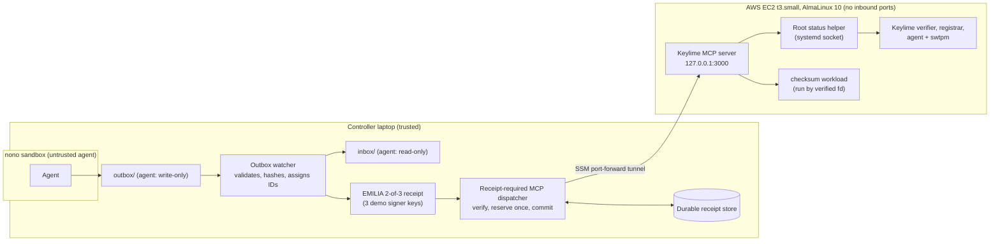

# Design Document

*Demo 3 version (11/16). Updated for `final-demo`.*

This document describes what we actually built for Demo 2 and Demo 3, how to
run it, what it shows, and what it does not show. Section 5 lists where each
demo differs from the milestones in our design proposal.

## 1. Architecture

An AI agent never gets to run a workload directly. It can only ask. A request
runs only if all of these hold:

1. the agent is confined by **nono** and can only write a request file;
2. a trusted watcher turns that file into an exact, hashed action;
3. **two of three** approvers sign an **EMILIA** receipt bound to that exact
   action;
4. a receipt-checking MCP dispatcher verifies the receipt and reserves it so it
   can be used only once;
5. the execution node's **Keylime** attestation is fresh, passing, and belongs to
   the expected agent;
6. the workload and input bytes match the approved digests and are executed
   from the already-verified file descriptors.

If any step fails, is unavailable, or is ambiguous, the request is denied.



### Components

| Component | Code | Role |
| --- | --- | --- |
| Agent request tool | `src/agent_tool/submit_request.py` | Writes one schema-valid request to the outbox (`*.tmp`, then rename). Convenience only, not a security boundary. |
| nono profile | `src/agent_tool/nono_profile.py` | Generates the sandbox profile: outbox write-only, inbox read-only, no network, credential variables stripped. |
| Request schema | `src/request_schema.json` | Strict JSON Schema (`additionalProperties: false`), allowlisted operations. |
| Outbox watcher | `src/controller/outbox_watcher.py` | Trusted. Opens files with `O_NOFOLLOW` and `O_NONBLOCK` and accepts only regular files. Enforces size limits, computes digests, checks the target allowlist, and assigns the occurrence ID and policy version. |
| EMILIA adapter and demo signers | `src/controller/emilia_adapter.py`, `src/demo/demo_controller.mjs` | Builds the action that approvers sign and issues 2-of-3 quorum receipts with three locally generated demo keys. |
| Receipt-required dispatcher | `src/controller/receipt_required_mcp.mjs` | Uses `@emilia-protocol/require-receipt` 0.9.0. Refuses with HTTP 428 unless a pinned issuer's receipt matches the exact action hash. Reserves the receipt in a durable store before the effect and burns it if the outcome is uncertain. |
| Keylime MCP client | `src/controller/keylime_mcp_client.mjs` | Calls the cloud MCP with a bearer token over HTTPS or a tunnelled loopback. Rejects stale, future-dated, or mismatched attestation results. |
| Keylime MCP server | `src/keylime_mcp/server.mjs`, `attest_and_deploy.mjs` | Runs on the node. Requires a valid launch permit, a fresh `PASS` for the configured agent UUID and a matching enrollment epoch, checks workload and input digests, records the occurrence in its launch ledger, then runs the workload from file descriptors 3 and 4. |
| Launch permits and ledger | `src/controller/permit_signer.mjs`, `src/keylime_mcp/permit.mjs`, `launch_ledger.mjs` | After verifying a receipt, the controller signs a 10-second Ed25519 permit bound to the action, tool, target, agent, enrollment epoch and receipt. The node holds only the public key and refuses a launch without a valid permit. Its ledger (atomic `mkdir`, then fsync) allows each `occurrence_id` to launch at most once, across concurrency and restarts. The bearer token now only controls who may connect. |
| AWS deployment | `infra/aws/` | CloudFormation template, deploy, tunnel, and teardown scripts. Access is through Systems Manager only. |

## 2. Design decisions

| Decision | What we chose | Alternatives and why not |
| --- | --- | --- |
| How intent leaves the sandbox | A structured JSON file in a write-only outbox | nono's built-in approval webhook was considered. The file handoff keeps the agent fully networkless and lets the trusted side compute every security-relevant field. |
| What the agent may request | An allowlisted `operation` plus digests, never shell strings | Free-form commands make "approve this exact action" meaningless. |
| Where security fields come from | The watcher computes digests, occurrence ID, and policy version itself | Fields the agent supplies are only claims. A request whose digest does not match is rejected. |
| Receipt format | EMILIA `require-receipt` gate with a v0.1 Action Risk manifest | We use EMILIA's gate rather than our own crypto. The v0.2 Action Control manifest is newer; migrating to it is follow-up work. |
| One-use receipts | Atomic `mkdir` reservation, then commit, with fsync | An in-memory set loses replay protection on restart. The scenario `replay_after_restart` shows it survives restarts. |
| Uncertain outcomes | Burn the receipt (`effect_indeterminate`) | Retrying could run the workload twice. The cost: a Keylime outage during a request uses up that approval, and a new approval is needed. |
| Running the approved bytes | Hash through an open fd, then execute `/proc/self/fd/3` on `/proc/self/fd/4` | Re-opening the path after hashing allows a swap between check and use. |
| Root-only Keylime status | A root systemd socket-activated helper, readable only by the `ec528-mcp` group | `sudo` is blocked by the service's `NoNewPrivileges=true`, and we did not want to remove that hardening. |
| Cloud | AWS EC2 (AlmaLinux 10, `t3.small`) | See Section 5 for why not MOC. Ubuntu has no Keylime package, while AlmaLinux 10 ships Keylime 7.14.1 and the Rust agent. |
| TPM | swtpm (software TPM) by default; NitroTPM on the TPM-enabled AMI | NitroTPM needs a custom UEFI AMI and an EK check without a vendor certificate (Section 3). It passed bootstrap, attestation and the end-to-end run on 2026-11-16. swtpm stays the quick default and proves the protocol flow, not a hardware root of trust. |
| SELinux | Kept enforcing; added a narrow `ec528_swtpm` policy module | Disabling SELinux would have been faster but weakens the whole host. |
| Language | Python for the agent side and watcher; Node.js for EMILIA and MCP | The proposal said Python throughout. EMILIA's receipt gate and the MCP SDK are JavaScript, and we use them directly rather than port the crypto. |

**Things that did not work at first, all fixed before the recorded runs:**

- **The watcher could be frozen.** The agent could create a FIFO in the outbox, and opening it blocked the watcher. Fixed with `O_NONBLOCK`, with a regression test.
- **The workload never received its files.** `execFile` in Node silently ignores the `stdio` option, so the verified file descriptors never reached the child. Fixed by switching to `spawn`, and tested on Linux.
- **Timeouts left processes running.** A timeout did not kill grandchildren of the workload. Fixed by killing the whole process group.
- **The status check could never run.** `sudo` inside a `NoNewPrivileges` service always failed. Fixed with the socket helper.
- **SELinux stopped swtpm from starting** under our systemd unit. Fixed with a policy module rather than disabling SELinux.

## 3. Setup

### Local machine (all non-cloud experiments)

Tested on macOS 26 (Darwin 25.1), Apple Silicon. Linux-only code paths were
also tested in a `node:22-bookworm-slim` container, and Experiments 0–4 in an
AlmaLinux 10 VM on Windows 11.

**Windows: use a Linux VM, not WSL2.** Our nono profile sets
`linux.af_unix_mediation = "pathname"`, which needs seccomp user notification.
WSL2 refuses it with `EBUSY`, so nono cannot start and every Experiment 1 case
exits 1 (the "blocked" cases then look like passes although nothing ran). A
Hyper-V (Windows Pro) or VirtualBox (Windows Home) VM running AlmaLinux 10 works.
Follow [`docs/windows-vm-setup.md`](windows-vm-setup.md).

| Dependency | Version used |
| --- | --- |
| Node.js | 24.11.0 (`>=20` required) |
| Python | 3.11 or newer (CI uses 3.11) |
| nono | 0.79.0 |
| `jsonschema` (Python) | 4.25.1 |
| npm packages | pinned in `package-lock.json` (`@emilia-protocol/require-receipt` 0.9.0, MCP SDK 2.x) |

```bash
git clone https://github.com/ec528-fall26/zero-trust.git
cd zero-trust
git checkout demo-2
npm ci
python3 -m venv .venv
.venv/bin/pip install -e .
# install nono 0.79.0: https://nono.sh/
nono --version
```

The commands below use `.venv/bin/python`, because the system `python3` usually
does not have `jsonschema`.

**Where to put the checkout.** Clone it under your home folder (for example
`~/ec528-demo`), not under `/tmp`, `/var`, or an iCloud-synced folder:

- nono's built-in macOS rules let any sandboxed program read `/private/var`
  (which holds the per-user temp folder) and read and write `/private/tmp`.
  A checkout there makes the confinement check fail, and the end-to-end
  experiment refuses to run (see Section 5).
- In iCloud Drive (`~/Documents`, `~/Desktop`), loading the Node packages took
  about 60 seconds instead of 0.1 seconds and stalled experiments.

### Cloud node (attestation and end-to-end experiments only)

These experiments need an AWS account. On our account the instance cost a few
cents per run.

| Dependency | Version used |
| --- | --- |
| AWS CLI | v2, plus the Session Manager plugin |
| Region / AMI | `us-east-2`, `ami-0281f4b4279b17b5b` (official AlmaLinux OS 10 x86_64) |
| Instance | `t3.small`, 16 GB encrypted gp3, auto-terminates after 4 hours |
| Keylime | 7.14.1-5.el10_2.1 (verifier, registrar, tenant; Rust agent) |
| swtpm | 0.9.0-6.el10_2 (live run; development only) |
| `cfn-lint` | run through `uvx cfn-lint` |

The deploy script expects an authenticated AWS CLI profile named
`ec528-deployer` that can create CloudFormation, EC2 and SSM resources. Create
or select the account credentials first; never commit access keys:

```bash
aws configure sso --profile ec528-deployer
aws sso login --profile ec528-deployer
aws sts get-caller-identity --profile ec528-deployer
```

The EC2 node also needs an IAM instance profile so it can register with Systems
Manager. The default is `EC528ZeroTrustInstanceProfile`. Validate it without
changing AWS, or create its least-privilege SSM role explicitly:

```bash
AWS_PROFILE=<iam-administrator-profile> ./infra/aws/setup-prerequisites.sh
AWS_PROFILE=<iam-administrator-profile> ./infra/aws/setup-prerequisites.sh --apply
```

The caller needs IAM permission to create the role/profile and attach the AWS
managed `AmazonSSMManagedInstanceCore` policy. Override the name with the
`InstanceProfileName` CloudFormation parameter if the course account already
provides an equivalent profile. A restricted deployer without
`iam:GetInstanceProfile` cannot validate whether the profile exists; the script
reports that authorization boundary instead of incorrectly reporting it as
missing.

```bash
./infra/aws/deploy.sh                 # validation only: lints the template, no charges
./infra/aws/deploy.sh --apply         # creates the instance (billable)
./infra/aws/open-tunnel.sh            # keep running: forwards localhost:3000 to the node
make demo2-bootstrap                  # 2-of-3 receipt enrolls the staged Keylime tenant
./infra/aws/teardown.sh ec528-zero-trust-demo   # deletes everything when finished
```

The experiments read the MCP bearer token from `build/aws-keylime/mcp-token`
(mode `0600`, ignored by Git). `make fetch-token STACK=<stack>` copies it from
the instance through Systems Manager. The token's value is therefore kept in
the account's SSM command history; it is per instance and useless once the
stack is torn down, but never display that command's output.

### Hardware TPM (NitroTPM)

The default node uses swtpm. To attest with the instance's NitroTPM instead:

```bash
AMI_ID=$(./infra/aws/build-nitrotpm-ami.sh)       # one time: copy of the pinned AMI registered with TPM v2.0 + UEFI
AMI_ID=$AMI_ID ./infra/aws/deploy.sh --apply       # wait ~15 min; node must say keylime-bootstrap-pending
./infra/aws/enable-nitrotpm.sh ec528-zero-trust-demo
make demo2-bootstrap                               # measured-boot policy is attached automatically
```

NitroTPM support can only be set when an AMI is registered, so
`build-nitrotpm-ami.sh` copies the AMI and re-registers its root snapshot with
`--tpm-support v2.0 --boot-mode uefi`. NitroTPM has no vendor EK certificate, so
`enable-nitrotpm.sh` does not simply disable EK checking: it reads this
instance's EK from the EC2 API (`GetInstanceTpmEkPub`, using the deployer's
credentials outside the node), checks that the local TPM holds the same EK, and
installs a Keylime `ek_check_script` that accepts only that EK. It then runs
`enable-hardware-tpm.sh` to move the agent to `/dev/tpmrm0`. Run the cloud
experiments with `KEYLIME_TPM_TYPE=nitrotpm`; Experiment 4 records the TPM type
the node reports and fails if it differs.

Check the TPM is the hardware one before trusting any result: on the node,
`sudo tpm2_getcap -T device:/dev/tpmrm0 properties-fixed | grep -A1 MANUFACTURER`
must print `0x414D5A4E` ("AMZN"); swtpm reports IBM.

Our first hardware run (2026-11-16) found four problems that swtpm had hidden.
All are fixed in these scripts, so a fresh deploy needs no manual steps:

| Problem | Fix |
| --- | --- |
| `test -s` on `binary_bios_measurements` always failed: kernel security files report size 0 | Both scripts read the first bytes instead |
| The registrar refused the agent: it still held the swtpm identity for the same UUID ("re-registration with different TPM identity is forbidden") | `enable-hardware-tpm.sh` deletes the registration and moves the swtpm `agent_data.json` aside |
| `keylime-policy create measured-boot` refused because Secure Boot is off on this AMI | The bootstrap helper passes `-i`; the policy still pins the measured firmware, boot loader and kernel events |
| IMA rejected the new EK check program (and, in our run, a helper we had edited by hand): neither was in the runtime policy built at deploy | `enable-nitrotpm.sh` rebuilds the runtime policy after installing the EK check, while enrollment is still pending, as the template does for its own helpers |

The last row is the system working as designed: a root-run file that changed
after the node was measured made attestation fail. Save the hardware results
under their own names so they do not overwrite the swtpm ones:

```bash
cp results/demo2-bootstrap.json results/demo3-nitrotpm-bootstrap.json
cp results/demo2-attestation.json results/demo3-nitrotpm-attestation.json
cp results/demo2-end-to-end.json results/demo3-nitrotpm-end-to-end.json
```

## 4. Running the experiments

Run every command from the repository root. Each experiment writes a JSON file
under `results/` containing the commit hash, whether the working tree had
uncommitted changes (`repository_dirty`), versions, per-scenario
expected/observed/pass, and its limitations. Raw responses are stored only as
SHA-256 digests, so no tokens or keys end up in Git.

### Experiment 0: unit and regression tests

| | |
| --- | --- |
| Supports | "The checks fail closed." Covers receipt binding, replay, malformed input, FIFO and symlink handling, and stale or mismatched Keylime results. |
| Command | `make ci PYTHON=.venv/bin/python` |
| Expected runtime | about 2 minutes |
| Expected output | Python `Ran 50 tests ... OK`; Node all 123 passing on Linux, with `fail 0`. The node-enforcement and fd tests need Linux and are skipped on macOS. |

### Experiment 1: nono confinement

| | |
| --- | --- |
| Supports | "The agent can only write a request. It cannot read back, reach the network, call the MCP directly, or read controller secrets." |
| Command | `make integration-nono PYTHON=.venv/bin/python NONO_BINARY=$(command -v nono)` |
| Expected runtime | under 1 minute |
| Expected output | JSON with all 9 cases `"passed": true` |

The 9 cases: `outbox_write_allowed`, `outbox_read_blocked`, `inbox_read_allowed`,
`inbox_write_blocked`, `network_blocked`, `direct_mcp_bypass_blocked`,
`receipt_store_read_blocked`, `signer_key_read_blocked`, `mcp_token_read_blocked`.

### Experiment 2: 2-of-3 exact-action authorization

| | |
| --- | --- |
| Supports | "No receipt, one signature, duplicate or untrusted signers, a changed action, expiry, and replay are all refused. Two distinct signers allow exactly one execution." |
| Command | `make demo2-authorization` (writes `results/demo2-authorization.json`) |
| Expected runtime | under 30 seconds |
| Expected output | `"status": "pass"` and 11 scenarios passing (see Section 5) |

### Experiment 3: cloud Keylime attestation (needs the AWS node and tunnel)

| | |
| --- | --- |
| Supports | "A fresh Keylime PASS lets the exact workload run. The wrong target is refused. Keylime being unavailable fails closed." |
| Command | `./infra/aws/prepare-demo.sh`, then `KEYLIME_MCP_URL=http://127.0.0.1:3000/mcp KEYLIME_MCP_TOKEN_FILE=build/aws-keylime/mcp-token KEYLIME_ACTION_FILE=build/aws-keylime/action.json KEYLIME_TPM_TYPE=swtpm make demo2-attestation` |
| Expected runtime | about 1 minute, after deploying the node (allow roughly 15 minutes) |
| Expected output | `results/demo2-attestation.json` with `"status": "pass"` and 3 scenarios passing |

### Experiment 4: one continuous end-to-end run (needs the AWS node)

| | |
| --- | --- |
| Supports | The headline claim: nono → watcher → EMILIA 2-of-3 → receipt dispatcher → SSM tunnel → cloud Keylime → workload → read-only inbox status, all in one run. |
| Command | `PYTHON_BIN=.venv/bin/python node experiments/demo2_end_to_end.mjs` (opens its own SSM tunnel; also reads `AWS_PROFILE`, `AWS_REGION`, `AWS_STACK_NAME`, `KEYLIME_MCP_TOKEN_FILE`) |
| Expected runtime | about 2 minutes. It deliberately stops the Keylime agent and waits for attestation to go stale. |
| Expected output | `results/demo2-end-to-end.json` with `"status": "pass"`, 7 scenarios passing, and a timeline from `nono_profile_generated` to `readonly_inbox_status_observed` |

**With a live model-driven agent (Demo 3):** add `--model-agent` (Experiment 11
explains the API key). The agent's request is then chosen by a Claude model
inside nono instead of a scripted command, and the result records the model,
its token usage and the arguments it chose.

**With real approvers (Demo 3):** add `--human-approvers`. The primary request
then waits for two people enrolled in `config/approvers/` (Experiment 9 explains
enrollment and signing) and writes `results/demo3-end-to-end-human.json`. The
Keylime outage and recovery scenarios still use fixture keys, labelled as
automation in the result.

### Experiment 5: policy digest pinning (local, no cloud)

| | |
| --- | --- |
| Supports | "`policy_version` is derived from the Keylime policy and the approval policy. Changing the Keylime allowlist, the approver roster, the quorum threshold or window, or the issuer key makes the gate or the node refuse an action approved under the old policies." |
| Command | `make drift-policy` (writes `results/drift-policy.json`) |
| Expected runtime | under 5 seconds |
| Expected output | `"status": "pass"` and 9 scenarios passing (listed in `results/drift-policy.json`) |

### Experiment 6: time drift (local, no cloud)

| | |
| --- | --- |
| Supports | "A receipt older than its lifetime (120 s by default) is refused. The node reports the attestation age it measured on its own clock. The controller refuses an age its timestamps do not support, and a node clock more than 5 seconds outside the interval the controller waited for the reply." |
| Command | `make drift-time` (writes `results/drift-time.json`) |
| Expected runtime | under 5 seconds |
| Expected output | `"status": "pass"` and 9 scenarios passing |

### Experiment 7: revocation at verify time (local, no cloud)

| | |
| --- | --- |
| Supports | "A receipt that verifies offline is refused if one of its signers has been revoked since, and the check fails closed when the revocation list is missing, stale, forged or rolled back." |
| Command | `make drift-revocation` (writes `results/drift-revocation.json`) |
| Expected runtime | under 5 seconds |
| Expected output | `"status": "pass"` and 9 scenarios passing |

`make drift` runs Experiments 5 to 7 together.

### Experiment 8: Demo 3 bound, restart-safe handoff (local, or AWS with `--aws`)

| | |
| --- | --- |
| Supports | "A launch happens only for the exact action a 2-of-3 quorum approved, on the enrolled node it was approved for, at most once. Substituted artifacts, inputs and targets, stale attestation, forged, expired or old-epoch permits, replays, a 10-client race, a service restart and a lost response never produce an extra launch." |
| Command | Local (Linux, no cloud): `make demo3-bridge` (writes `results/demo3-bridge.json`). AWS: deploy, `make fetch-token`, `make demo2-bootstrap`, `./infra/aws/prepare-demo.sh`, then `make demo3-bridge-aws` (writes `results/demo3-bridge-aws.json`; opens its own SSM tunnel). |
| Expected runtime | Local: under 30 seconds. AWS: about 2 minutes after deployment. |
| Expected output | `"status": "pass"`. Local: 13 scenarios passing. AWS: 11 passing and 2 marked `not_run` (staged-input substitution and stale attestation, which need root changes on the node or are covered by Experiment 4). Every scenario's `launches` equals `expected_launches`, and `reconciliation` lists the node's ledger entry for each occurrence used. |

Launches are counted from process-start records the workload writes locally, and from the node's launch ledger on AWS. The lost-response scenario shows the at-most-once trade-off: the workload ran, the controller never learned the result, the receipt was burned as `effect_indeterminate`, and the ledger records `succeeded` for reconciliation.

### Experiment 9: two people approve from separate credentials (local)

| | |
| --- | --- |
| Supports | "Approval requires two different enrolled people, each signing on their own machine. The controller holds only their public keys, shows a pending request after one approval, and refuses unenrolled keys, forged signatures, the same person twice, signoffs for another request, and signoffs after the window." |
| Setup | Each approver runs `node tools/approver.mjs keygen --role <role> --name "<name>"` on their own machine and adds the printed public record as `config/approvers/<role>.json` (at least three people; see `config/approvers/README.md`). |
| Command | `make demo3-human-approval`. It writes `build/approvals/<receipt_id>/request.json`; send it to two approvers, each runs `node tools/approver.mjs sign request.json` and returns `signoff-<role>.json`, which goes in `build/approvals/<receipt_id>/signoffs/`. `make demo3-human-approval-fixture` runs the same scenarios with in-process keys (automation). |
| Expected runtime | Human waiting time plus under 5 seconds. Requests expire after `approval_window_sec` (900 s). |
| Expected output | `results/demo3-human-approval.json` with `"status": "pass"`, `approver_mode: "human"`, 7 scenarios passing (`no_receipt_before_approval`, `unenrolled_key_refused`, `pending_after_one_approval`, `same_person_twice_counts_once`, `changed_action_after_approval`, `approved_action_launches_once`, `receipt_replay_refused`), and `human_wait_seconds`. Launches are counted from process-start records of the real node code. |

The approver tool recomputes the action hash and the assurance-context hash
from the fields it displays before signing, so an approver never signs a
summary written by the agent or the controller. Approval requires typing the
first 8 hex characters of the action hash. The signoff uses the WebAuthn
format the EMILIA gate already verifies (`key_class: "A"`, pinned public key,
pinned 2-of-3 policy with `distinct_humans: true`).

### Experiment 10: repeated trials and latency against the Demo 2 baseline

| | |
| --- | --- |
| Supports | "Across repeated trials, no scenario produces an unauthorized or duplicate launch", and the cost of the gate. |
| Command | Local: `make demo3-trials` (`TRIALS=20 LATENCY_RUNS=50` by default). AWS, after the Experiment 8 prerequisites: `make demo3-trials-aws TRIALS=5 LATENCY_RUNS=20`. |
| Expected runtime | Local: under 1 minute. AWS: several minutes per trial (the restart scenario restarts the node service over Systems Manager). |
| Expected output | `results/demo3-trials.json` with `"status": "pass"`; locally 260/260 scenario runs (13 scenarios x 20), `unauthorized_or_duplicate_launches: 0`, launches observed equal to launches expected (140), median/p95 latency for the gated path and the baseline, `workload_scaling` for 1 KB, 1 MB, 16 MB and 64 MB inputs, and `over_limit.passed: true`. |

Demo 2 ran each scenario once, and its node launched for anyone holding the MCP
bearer token. Here the gated path is the EMILIA receipt gate, controller,
permit and node; the baseline calls the same node directly with a valid permit,
so the reported overhead covers the controller-side gate only. In a local run
on 2026-11-15 the gated median was 15.2 ms (p95 21.6 ms) against a baseline
median of 11.3 ms.

**Workload size.** Demo 2's workload hashed a 32-byte file. The same paired
measurement is repeated with pseudo-random inputs of 1 KB, 1 MB, 16 MB and
64 MB (`--sizes`, `--size-runs`). The node hashes the input before launching
and the workload hashes it again, so cost grows with size while the gate's
cost does not: in the local run above, a 64 MB input took a median of 184 ms
on both paths. The node reads at most 64 MiB of workload material into memory;
an input 1 MiB over that limit must be refused with no launch
(`over_limit`). Larger workloads would need the node to hash from the verified
descriptor in a stream instead.

### Experiment 11: live model-driven agent request (local)

| | |
| --- | --- |
| Supports | "A real model, confined by nono, can only ask: it chooses a request, the watcher rebuilds it from the bytes on disk, and it launches once after two approvals. Inside the sandbox the real API key is absent, and the controller's state, the node's port, and every host except the model API (through nono's proxy) are unreachable." |
| Setup | **Reference path (agreed with our TA):** the API agent with the project's Claude Console API key in `EC528_ANTHROPIC_API_KEY`. The key is scoped to a dedicated workspace with a spending limit and is shared with course staff privately, never in the repository. Read it without echoing: `read -rs EC528_ANTHROPIC_API_KEY; export EC528_ANTHROPIC_API_KEY`. nono 0.79 or newer. *Optional:* Claude Code as the agent (`--agent claude-code`), with a token from `claude setup-token` in `EC528_CLAUDE_OAUTH_TOKEN`. |
| Command | `make demo3-model-agent` (for real approvers: `node experiments/demo3_model_agent.mjs --human-approvers`). Optional: `make demo3-claude-agent`. `make demo3-model-agent-replay` reproduces the recorded decision with no credential at all. |
| Expected runtime | Under 30 seconds plus approval time. One model call of at most 1,024 output tokens. |
| Expected output | `results/demo3-model-agent-claude-code.json` (or `demo3-model-agent.json`) with `"status": "pass"`, `agent_mode` `"live_claude_code"` or `"live_model"`, 6 scenarios passing (`sandbox_confinement_with_model_route`, `model_request_published`, `watcher_bound_trusted_material`, `pending_after_one_approval`, `model_request_launches_once`, `receipt_replay_refused`), and the agent's decision in the matching `*-transcript.json`. |

**Claude Code as the agent (optional).** Following the nono project's own agent profiles,
the agent can be Claude Code itself (`claude -p`), not only our minimal
script. It runs under *our* profile rather than nono's Claude Code profile,
because that profile is built to let a coding agent work freely, which is
wider than our claim that the agent can only ask. Claude Code is given the
Bash tool, and its only auto-approved command is
`python3 model_agent.py --submit ...`; anything else is denied in
non-interactive mode, and nono confines whatever does run. It authenticates
with a subscription token from `claude setup-token`, which can only make
model requests. nono's proxy injects that token as a bearer header, so the
agent sees only a phantom value in `CLAUDE_CODE_OAUTH_TOKEN`; the variable
holding the real token is denied by name, and only allow-listed variables
reach the agent. Its configuration directory is a folder inside the sandbox
workdir, so it never sees the operator's own Claude Code settings.

**How the API key is handled.** The sandbox profile is generated with
`--model-credential-env EC528_ANTHROPIC_API_KEY`. That replaces `"block": true`
with proxy-only networking: nono's credential proxy runs in the supervisor,
outside the sandbox, reads the key from the supervisor's environment through an
`env://` reference, and forwards only to `https://api.anthropic.com`. The agent
receives a loopback base URL and a per-session phantom token (in
`EC528_MODEL_PHANTOM`); the proxy swaps the phantom for the real key. The
profile still strips every `*KEY*` variable from the agent. The agent uses only
the Python standard library and refuses any model endpoint that is not
loopback. The confinement probe checks from inside the sandbox that no value in
its environment looks like an Anthropic key, that `api.anthropic.com` and other
hosts cannot be reached directly, and that the node's port and the
controller's state cannot be reached.

The model sees only the task, target names, input file names and their
digests; it never sees the key, approver material or tokens. Its transcript
(request body without headers, and the response) is committed as evidence.
With the API agent each run costs one model call (about half a cent); the
project key's workspace spending limit caps any mistake. Course staff rerun the
experiment live with that key, as agreed with our TA. Anyone without a key can
reproduce the run with `make demo3-model-agent-replay`, which replays the
recorded decision through the same sandbox, watcher, approvals and node.

## 5. Claims and limitations

### Results recorded for Demo 2

Each result file records its exact source commit, dependency versions,
timestamps, and whether the working tree was dirty. The refreshed continuous
and IMA runs were generated from commit `7826c10` on 2026-10-20/21 with
`repository_dirty: false`. The instance IDs below are historical evidence; the
CloudFormation stack and all tagged EC2, EBS, and security-group resources were
deleted after the runs.

**Authorization** (`results/demo2-authorization.json`, 11/11):

| Scenario | Observed |
| --- | --- |
| `missing_receipt` | refused |
| `one_signer_pending` | pending, no receipt issued |
| `duplicate_signer` | not counted twice |
| `untrusted_signer` | refused |
| `two_distinct_signers` | receipt issued |
| `receipt_target_binding` | refused (`action_hash_mismatch`) |
| `exact_action` | executed once |
| `immediate_replay` | refused (`replay_refused`) |
| `replay_after_restart` | still refused after restart |
| `expired_evidence` | refused (`receipt_expired`) |
| `one_signer_expiry` | expired without execution |

**Continuous end-to-end run on AWS** (`results/demo2-end-to-end.json`, 7/7,
instance `i-00cf93b48c76bef44`, terminated):

| Scenario | Expected | Observed |
| --- | --- | --- |
| `no_receipt` | denied | HTTP 428 |
| `one_of_three_signatures` | pending and denied | HTTP 428, receipt not issued |
| `action_changed_after_approval` | denied | HTTP 428, `action_hash_mismatch` |
| `exact_action_end_to_end` | executed once | HTTP 200, Keylime verdict `trusted`, workload ran |
| `used_receipt_replay` | denied | HTTP 428, `replay_refused` |
| `keylime_agent_stopped` | denied | HTTP 500, `effect_indeterminate`, workload did not run |
| `keylime_agent_recovered` | executed once | HTTP 200 after re-enrollment and fresh attestation |

**Cloud attestation** (`results/demo2-attestation.json`, 3/3): fresh attestation
allows the exact workload; the wrong target is denied; Keylime unavailable fails
closed.

**IMA runtime-integrity run** (`results/ima-tamper.json`, 5/5, same terminated
instance):

| Scenario | Observed |
| --- | --- |
| `ima_active_before_tamper` | kernel IMA policy active; Keylime status `PASS` |
| `clean_node_allows_exact_workload` | HTTP 200; exact workload executed |
| `unapproved_program_measured` | unexpected executable recorded in the IMA log |
| `verifier_detects_unapproved_program` | Keylime changed to `FAIL` with `ima.validation.ima-ng.not_in_allowlist` in at most 2.2 seconds |
| `approved_request_denied_after_tamper` | HTTP 500 fail-closed response; workload did not execute |

### Results recorded for Demo 3

Generated from the files in `results/` by `make demo3-summary` (which rewrites
the block below). "Dirty tree" means the run used uncommitted changes, which
were committed straight afterwards. Approvals in the NitroTPM run are fixture
keys; the two-person approval was run on the swtpm node the same night.

`make demo3-replay` builds `docs/demo3-replay.html` from the same files: a page
that replays the recorded runs step by step (open it in a browser). It runs
nothing live.

<!-- demo3-summary:start -->
| Experiment | Result | Detail |
| --- | --- | --- |
| Bound handoff, local (Exp. 8) | **pass** at `ce01a63`, dirty tree | 13/13 scenarios |
| Bound handoff, AWS (Exp. 8) | **pass** at `00e0290`, dirty tree | 11/11 scenarios |
| Repeated trials, local (Exp. 10) | **pass** at `ce01a63`, dirty tree | 260/260 runs, 0 unauthorized or duplicate launches |
| Repeated trials, AWS (Exp. 10) | not run |  |
| Two people approve (Exp. 9) | **pass** at `5311bd9` | 7/7 scenarios, human, 298.627 s human wait |
| Live model agent (Exp. 11) | **pass** at `5311bd9` | 6/6 scenarios, claude-sonnet-5-5 |
| End to end, people + model on AWS (Exp. 4) | **pass** at `5311bd9`, dirty tree | 7/7 scenarios, tpm swtpm, agent live_model |
| Cloud attestation (Exp. 3) | **pass** at `0aabc18`, dirty tree | 3/3 scenarios |
| NitroTPM bootstrap (Section 3) | **pass** at `aa71229`, dirty tree | 3/3 scenarios |
| NitroTPM attestation (Exp. 3) | **pass** at `aa71229`, dirty tree | 3/3 scenarios, verdict trusted |
| NitroTPM end to end, model agent (Exp. 4) | **pass** at `aa71229`, dirty tree | 7/7 scenarios, tpm nitrotpm, agent live_model, approvals fixture_automation |

| Measurement | Demo 2 | Demo 3 |
| --- | --- | --- |
| Runs per scenario | 1 | 20 |
| Launches from a caller holding only the bearer token | possible (node checked the token only) | 0 in 20 attempts |
| Gated launch latency, median / p95 | not measured | 34.8 / 41.2 ms |
| Overhead of the gate over a direct permitted call, median | not measured | 11.1 ms |
| Input 1KB: gated / baseline median | 32-byte input only | 46.8 / 28.8 ms |
| Input 1MB: gated / baseline median | 32-byte input only | 52.7 / 37.7 ms |
| Input 16MB: gated / baseline median | 32-byte input only | 132.8 / 111.8 ms |
| Input 64MB: gated / baseline median | 32-byte input only | 419 / 380.6 ms |
| Input over the 64 MiB node limit | not tested | refused, 0 launches |
<!-- demo3-summary:end -->

### What these results do not show

- **swtpm is not a hardware root of trust.** It proves the Keylime protocol and
  our fail-closed handling, not that a physical chip vouched for the machine.
  The NitroTPM runs remove this for the runs labelled `nitrotpm`; the rest of
  the Demo 3 results (two-person approval, AWS bridge) are still swtpm.
- **NitroTPM trust rests on AWS.** The EK is pinned from the EC2 API, not a
  vendor certificate, so we trust AWS's control plane and the Nitro hypervisor.
  The AMI boots without Secure Boot (measured-boot policy uses `-i`), and the
  runtime policy is rebuilt on the node once the EK check is installed: trust on
  first use, as before.
- **The checker and the checked machine are the same.** The Keylime verifier,
  registrar, agent, swtpm, and MCP all run on the one instance being attested.
  A compromised instance could lie about itself.
- **In Demo 2 the three EMILIA signer keys were on one laptop.** That proved the
  2-of-3 protocol, not independent human approval. Demo 3 adds enrolled approvers
  (Experiment 9): each person signs on their own machine and the controller
  holds only public keys. Those keys are software keys in files, not hardware
  authenticators, and the signoff uses the WebAuthn format without a browser
  ceremony.
- **IMA is real kernel measurement, but the TPM is emulated.** Linux IMA
  records executed files, then a userspace emulator copies PCR 10 into swtpm.
  Root on the node could forge this flow. The policy was generated from the
  node at boot (trust on first use), and tmpfs and the SSM per-command script
  directory are outside the measured set.
- **There is a freshness window.** We accept attestation up to 30 seconds old.
  A node that fails inside that window is still trusted until the result goes
  stale. The outage scenario waits 35 seconds for this reason.
- **An outage uses up the approval.** When Keylime is down, the receipt is
  burned as `effect_indeterminate` rather than retried, so the approvers must
  sign again.
- **What the end-to-end "one of three" scenario actually tests.** With one
  signature, no receipt exists yet, so the dispatcher sees the same "no receipt"
  case as `no_receipt`. A forged receipt carrying only one valid signature is
  refused by the gate in the unit test
  `the production profile accepts a real 2-of-3 quorum receipt`, but not in the
  live cloud run.
- **The controller trusts the node's report.** The cloud MCP returns the
  attestation verdict and evidence digest itself, so the controller cannot
  independently check them.
- **A prior temp-folder layout exposed read access to controller state.** It was
  fixed by moving experiment state under `build/runs/`. Before starting, the
  current end-to-end experiment asks `nono why --json` to confirm that every
  controller-only path is denied and fails closed otherwise. The refreshed
  result records `controller_state_unreadable_by_sandbox` with seven paths
  checked.
- **nono enforcement was first tested on macOS (Seatbelt).** Experiment 1 also
  passed 9/9 under Linux Landlock in an AlmaLinux 10 VM on Windows 11
  (2026-11-04). It cannot run under WSL2 (see Section 3).
- **Node-side enforcement has run on AWS, but not every case.** Permits and the
  launch ledger ran on a live instance in Experiment 8 on AWS (2026-11-14): 11
  scenarios passed, including a bearer token without a permit, forged, expired
  and replayed permits, and a 10-client race. `staged_input_substituted` and
  `stale_attestation` were not run there. `make demo2-bootstrap` must run
  before any workload experiment, because it writes the controller's record of
  the enrollment to `build/aws-keylime/enrollment.json`. The Azure scripts ship
  the new modules but do not configure a permit key, so that server refuses to
  start.
- **A permit is the controller's word.** The node verifies the controller's
  signature, not the approvers' signatures. Sending the receipt to the node so
  it can verify the quorum itself is a stronger follow-up.
- **The workload shares the MCP service's user.** It could alter the launch
  ledger. The proposal calls for a separate identity; this is not done yet.
- **A node-side refusal still burns the approval**, including a refused permit,
  because the receipt was already reserved (`effect_indeterminate`).
- **The model agent chooses from a catalog the controller offers.** It cannot
  name arbitrary files or targets, and the watcher recomputes every digest, so
  a wrong or injected choice is refused rather than run. A prompt-injection
  scenario against the agent is final-demo work. The credential proxy keeps the
  API key out of the sandbox, not off the controller host.
- **Small scale.** Each Demo 2 scenario ran once. Experiment 10 now repeats the
  bridge scenarios 20 times and measures 50 paired latency runs locally; the
  proposal's 20-trial bootstrap and attestation classes and the AWS
  repetitions are not done yet.

### Changes from the Demo 2 milestones in the proposal

We are announcing these changes, as the course rules require:

| Proposal milestone | Status | Change and reason |
| --- | --- | --- |
| Exact-action 2-of-3 authorization (`demo2_authorization.sh`) | **Met** | As planned, plus target-binding and restart-replay cases. |
| Keylime enrollment with measured-boot and IMA runtime policy | **Met in Demo 3** | Enrollment always attaches the generated IMA policy. On the NitroTPM AMI (Section 3) enrollment also attaches a measured-boot policy, and on 2026-11-16 the verifier checked PCRs 0–16 against the boot log and rated the node trusted (`results/demo3-nitrotpm-*.json`). swtpm evidence proves IMA only. |
| Quorum-controlled tenant bootstrap through Keylime secure payload | **Met** (AWS, swtpm and NitroTPM) | CloudFormation now stages the runtime policy and protected payload but leaves the tenant unenrolled. `demo2_bootstrap` requires a receipt bound to the agent, policy digest, payload digest and occurrence before the node-local root helper invokes `keylime_tenant --include`. Missing, one-signer, changed and replayed approvals fail before enrollment. |
| Platform: MOC, or local KVM for this milestone | **Changed** | AWS EC2 with swtpm was used because the team had AWS credits and Systems Manager access while the MOC integration was not ready. The platform substitution is disclosed here rather than treated as equivalent hardware attestation. |
| Nono-confined agent request (planned for Demo 3) | **Started early** | Already part of the Demo 2 end-to-end run. Two real people approving from separate credentials is still Demo 3 work. |

### Demo 3 milestones

| Proposal milestone | Status | Evidence and changes |
| --- | --- | --- |
| Bound, restart-safe handoff (`demo3_bridge.sh`) | **Met** | Experiment 8: 13/13 locally and 11 run + 2 not run on AWS. Experiment 10 repeats it 20 times with 0 unauthorized or duplicate launches. |
| Real agent and human-in-the-loop (`demo3_confinement.sh`) | **Met** | The agent is a Claude model inside nono (Experiment 11, and `demo2_end_to_end.mjs --model-agent` on AWS). Two people approve from separate credentials (Experiment 9, `--human-approvers`). On 2026-11-15 two teammates signed from their own laptops: locally (Experiment 9, pending after one signoff) and on AWS with the live model agent (Experiment 4 `--human-approvers`). These replace a separate `demo3_confinement.sh`. `tools/verify_evidence.py` was not built; each result file records per-stage evidence instead. |
| Realistic workload (course milestone bar) | **Measured locally** | Experiment 10 measures 1 KB to 64 MB inputs against Demo 2's 32-byte input, and found the node's 64 MiB material limit, which fails closed. |
| NitroTPM measured boot (planned for Demo 3) | **Met** | `build-nitrotpm-ami.sh` and `enable-nitrotpm.sh` (Section 3) build the TPM-enabled AMI and pin the EK from the EC2 API instead of disabling EK checks. Bootstrap, attestation and the end-to-end run with the live model agent passed on the hardware TPM (manufacturer AMZN). The four problems the first run found are fixed (Section 3). |

### Final infrastructure

The proposal asks for the final evaluation on MOC or an explicitly agreed
similar platform. These decisions were agreed on 2026-11-15:

| Question | Decision | What it requires for the final |
| --- | --- | --- |
| Platform | **AWS EC2** (`us-east-2`, AlmaLinux 10), instead of MOC | Nothing new; Demos 2 and 3 already run there. |
| TPM | **NitroTPM** | Hardware run passed on 2026-11-16 (Section 3). For the final, run the full evaluation on it, including a measured-boot mismatch. |
| Verifier placement | **Keylime verifier and registrar on a separate instance** from the attested node | A second instance and network path in `infra/aws/` so the checker is no longer the checked machine. This removes the limitation "the checker and the checked machine are the same" (Section 5). |

## 6. Drift controls

*Added after Demo 2, in response to the design analysis "State Drift Between Keylime and EMILIA Quorum". That analysis is a design study, not a description of an existing integration. These controls have been run locally (Experiments 5 to 7) but not on the AWS node.*

Keylime vouches for the machine, EMILIA vouches for the humans, and the action runs later. Each check can be true at its own moment and false by the time the action runs. These controls narrow the gaps.

| Control | What it does | Where | Setting |
| --- | --- | --- | --- |
| Policy digest pinning | `policy_version` becomes `pd1-` plus the first 60 hex characters of a SHA-256 over canonical JSON of the Keylime policy file digest and the approval policy (issuer keys, approver keys, quorum policies, relying party, origins). Any change gives a new version. The gate refuses another version with `policy_version_mismatch`. | `src/keylime_mcp/policy_digest.mjs`, `src/controller/policy_digest.py`, gate option `keylimePolicySha256`, watcher flags `--keylime-policy` and `--approval-policy`, node variables `KEYLIME_POLICY_FILE` and `KEYLIME_APPROVAL_POLICY_FILE` | Optional. The fixed label (`--policy-version`, `KEYLIME_POLICY_VERSION`) still works. |
| Short receipt lifetime | A receipt is refused once older than `max_age_sec`. The window in which the two approvers must sign is separate and longer (900 s). | `public/.well-known/agent-actions.json`, `DEFAULT_RECEIPT_MAX_AGE_SEC` in `src/controller/emilia_adapter.py`, `manifestWithReceiptMaxAge` in `receipt_required_mcp.mjs` | 120 s (was 900 s). A test checks the manifest and the adapter agree. |
| Node-reported attestation age and bounded skew | The node returns `age_seconds` and `node_time` from its own clock. The controller checks the age is consistent with the node's two timestamps and at most 30 s, and that `node_time` lies within 5 s of the interval in which the controller was waiting. | `src/keylime_mcp/attest_and_deploy.mjs`, `src/controller/keylime_mcp_client.mjs` | 30 s age, 5 s skew |
| Revocation at verify time | The gate loads a signed revocation list before reserving a receipt. A receipt is refused if any signer is listed, or if the list is missing, unverifiable, older than 300 s, or older in sequence than one already seen. A refusal here does not burn the receipt. | `src/controller/revocation.mjs`, gate option `revocation` | Optional. Off unless a checker is passed. |
| Post-request attestation | With `KEYLIME_REQUIRE_FRESH_ATTESTATION=1` the node reads the verifier's `attestation_count`, waits until it has risen by 2, then runs the workload. The first increase may be a quote already in flight when the request arrived; the second was requested by the verifier, with its own nonce, after the request. The controller refuses a result that lacks `fresh_after_request`. It fails closed on timeout (default 15 s), a status that stops passing, or a count that is missing or goes backwards. | `src/keylime_mcp/attest_and_deploy.mjs`, `src/controller/keylime_mcp_client.mjs`, `src/keylime_mcp/server.mjs` | Optional, off by default. Not yet run against a real Keylime node. |

**What these controls do not do**

- **Not deployed to AWS.** `infra/aws/install-mcp.sh` still sets the fixed label `KEYLIME_POLICY_VERSION=demo-2.1`, so the recorded cloud runs do not use policy pinning, and no revocation checker is configured. The node's Keylime policy is generated at boot, so the controller does not know its digest in advance. Deciding how it learns it is open work.
- **No caller-chosen nonce.** Post-request attestation (above) shows that the verifier quoted the node again after the request, but the controller does not choose the nonce and cannot verify the quote itself. Without the option the node still reads Keylime's last periodic result, so the 30 second window in Section 5 remains. The option has unit tests only and is off in the AWS deploy.
- **A node-side refusal still burns the approval.** The refusal happens after the receipt is reserved (`effect_indeterminate`). Experiment 5 shows this for a node whose Keylime policy changed.
- **The controller trusts the node's report of its own age and clock.** A compromised node can lie about both. The consistency and skew checks catch misconfiguration and drift, not a malicious node.
- **Receipt age uses the controller's clock.** A skewed controller clock is not detected.
- **Revocation list limits.** The list authority is a local demo key and the list is served from memory. The highest sequence seen is kept in memory only, so a controller restart forgets it. A signer is refused whether the key was revoked before or after signing.
- **Receipt lifetime and live demos.** With a 120 s lifetime, a narrator has two minutes between the second approval and the execute step. For a slower walkthrough use `manifestWithReceiptMaxAge(manifest, 900)`.
